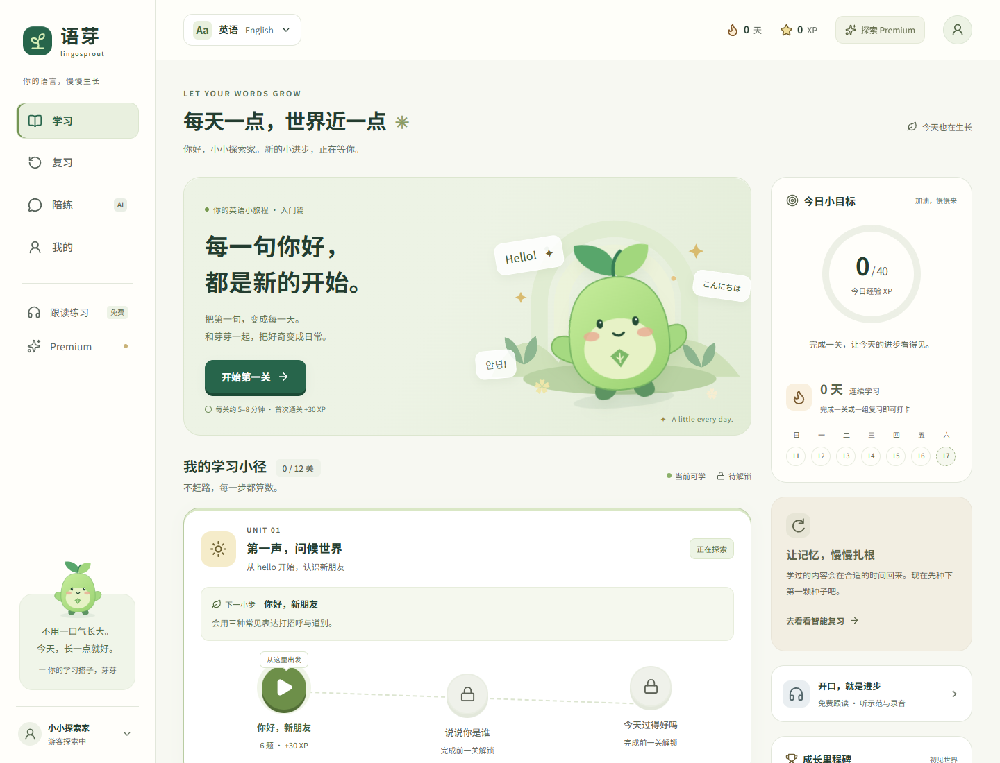
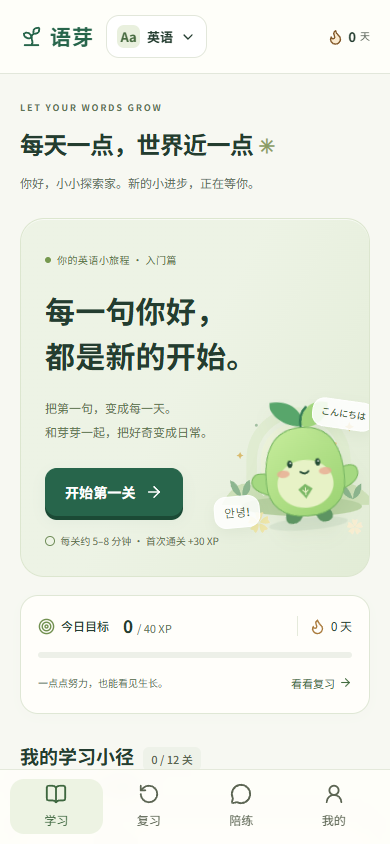

# 语芽 LingoSprout

每天一小步，让新语言慢慢发芽。面向中文母语初学者的游戏化多语言学习 Web App，支持英语、日语、韩语。

[在线学习](https://lingosprout-illit18349619989-9055.vercel.app) · [邮箱登录](https://lingosprout-illit18349619989-9055.vercel.app/login) · [LingoSproutSCAN](https://lingosprout-illit18349619989-9055.vercel.app/scan) · [管理后台](https://lingosprout-illit18349619989-9055.vercel.app/admin)

## 已实现

- 三种语言各 4 个入门单元、12 个关卡，共 36 关、216 道题。选择、匹配、组句、填空、听音选择五种题型。
- 课程介绍、错题稍后重练、首次正确率与重试分开统计、通关结算、解锁与防重复刷取奖励。
- 各语言独立保存进度与知识点复习；共享本地日期打卡、学习目标、经验、等级与成就。
- 免费跟读：示范音、可用时慢速播放、主动录音与回放。无声音或麦克风被拒绝时有提示；不提供发音评分。
- 邮箱与密码注册、登录、修改密码、服务端会话、浏览器设备绑定、查看并退出其他设备。
- Premium 介绍与申请。每个账号累计最多申请三次，最多一份待审申请；有效期内不重复申请。
- 管理员审批、拒绝、直接授权、延长或撤销 Premium。必须设置有效期，最长三年；到期恢复免费权益。
- 所有者、管理员、成员三种权限。仅所有者能任免管理员；可创建和授予展示称号，称号不授予权限。
- 管理员后台配置 DeepSeek 密钥、模型 ID、免费和 Premium 额度、站点标题、申请开关；有管理操作记录。
- LingoSproutSCAN 独立扫码程序：主动开启相机扫码，或粘贴本站二维码链接；已登录手机核对数字并确认电脑登录。
- DeepSeek 场景对话、翻译、提示、展开纠错、Premium 总结与最近 50 次历史。失败不扣额度，重复请求不重复扣除。





品牌、吉祥物、插画与中文界面均为本项目原创。Next.js 16、React 19、TypeScript、原生 CSS；依赖已锁定。

## 本地运行

需要 Node.js 22+（部署使用 24）与 npm。首次运行复制配置文件；已有配置不要覆盖：

```powershell
Copy-Item .env.example .env.local
npm ci
npm run dev
```

打开 http://127.0.0.1:3000 。也可使用仓库内的 `启动语芽.cmd`。

不配置外部服务也能使用游客课程、复习、跟读和开发环境演示陪练。生产环境的账户、后台和陪练需要数据库。所有环境均禁止自助或演示开通 Premium。

```powershell
npm run typecheck
npm test
npm run test:e2e
npm run build
npm start
```

浏览器测试默认使用 Playwright Chromium，可运行 `npx playwright install chromium`；也可通过 `PLAYWRIGHT_CHROMIUM_EXECUTABLE_PATH` 指定系统 Chrome。

## 账户与数据库

在独立 Supabase 项目中按顺序首次执行 `database/schema.sql`、`database/accounts.sql`。后者是首次建库脚本，不要在已有账户表上反复执行。配置：

- `SUPABASE_URL`、`SUPABASE_PUBLISHABLE_KEY`。
- `SUPABASE_SERVICE_ROLE_KEY`，或使用下述 Edge 后端独立凭证。
- `CONFIG_ENCRYPTION_KEY`：32 字节随机数的十六进制字符串，用于 AES-256-GCM 加密管理员保存的 API 密钥。更换此值后需重新保存 AI 密钥。
- 生产环境设置 `APP_ORIGIN` 为准确的 HTTPS 站点源，不带末尾斜线。备用页面域名会跳转到此源。

当前部署使用 `supabase/functions/lingosprout-backend/index.ts` 中的服务端网关。部署时将占位符替换为独立随机凭证的 SHA-256 摘要；原凭证只写入 Web 服务端的 `BACKEND_GATEWAY_KEY` 环境变量。网关在运行环境中读取 Supabase 的服务密钥，不向浏览器返回。必须保留函数内的凭证校验与资源白名单；若使用这种独立认证，Edge 函数设置 `verify_jwt=false`。

业务表开启 RLS，浏览器角色没有写权限。所有管理员变更同时经过 API 角色检查和数据库事务内角色检查。角色来自数据库，不信任用户元数据中的角色声明。

普通公开 Supabase 注册会被数据库触发器拦截。Web 服务端先原子预留设备名额，再使用一次性票据创建账户；触发器消耗票据并累计注册量。

首次安装时，可先注册站点运营账号，再由数据库运营者在 SQL Editor 中将该账号设为唯一所有者：

```sql
update public.ls_accounts
set role = 'owner'
where email = '替换为运营者自己的邮箱'
  and not exists (select 1 from public.ls_accounts where role = 'owner');
```

当前公网部署已完成所有者初始化。仓库不包含管理员密码、真实密钥、账户会话或私有环境文件。

## 管理 Premium 和 AI

1. 使用管理员邮箱登录 `/login`，进入 `/admin`；普通成员看不到后台内容。
2. 在“申请审核”中通过或拒绝申请。批准时选择到期时间，可给申请人留下简短说明。
3. 在“账号与称号”中授权、延长、撤销 Premium，管理称号或停用账号。停用立即使已有登录失效。
4. 在“API 与站点”中保存 DeepSeek 密钥，检查连接并读取官方当前模型列表，再选择模型 ID。
5. 默认免费每天 5 条、Premium 100 条；消息、提示、总结分别计 1 条。额度按 Asia/Shanghai 日期重置，失败不扣除。

API 密钥加密保存，读取配置只显示已配置状态，不回显。模型 ID 可配置，当前默认 `deepseek-flash`，2026-10-17 核对 [DeepSeek 官方文档](https://api-docs.deepseek.com/quick_start/pricing)。请求通过服务端调用 `https://api.deepseek.com/chat/completions`，接口、结构和超时有测试覆盖。不要将 API 密钥放入 `NEXT_PUBLIC_` 环境变量。

未配置密钥时使用明确标注的固定演示脚本。当前没有真实支付，也没有收费购买入口；Premium 只接受申请后管理员授权。

## LingoSproutSCAN

电脑打开 `/login` → 选择“扫码登录” → 生成二维码。已登录的手机打开专属 `/scan` 页面，主动开启相机扫描，核对电脑与手机上的六位确认码，再选择确认或拒绝。

二维码两分钟过期，只能使用一次。扫描凭证放在 URL fragment 中，读取后立即清除地址栏与页面历史中的 fragment；服务端仅保存凭证哈希。轮询凭证和扫描凭证互相独立。只有发起二维码的浏览器设备能原子消耗确认结果并获得会话。扫码不自动确认，也不会把手机的现有会话令牌复制给电脑。

相机权限被拒绝时可粘贴本站二维码链接。仅接受当前站点 `/scan` 链接，不接受其他网站的登录二维码。

## 设备与邮箱的明确范围

- 设备绑定采用服务端生成的 HttpOnly 浏览器凭证。累计注册十个账号后，第十一个被数据库锁和计数约束拦截；退出或停用账号不会归还名额。
- 纯 Web 无法可靠识别清除站点数据、无痕窗口、不同浏览器后的同一台物理设备。因此这是**浏览器设备凭证的上限，不是硬件身份保证**。若需要物理设备级限制，需原生设备认证或独立反滥用服务。
- 邮箱目前作为登录名，**尚未验证邮箱所有权**。Supabase 自动确认仅使邮箱密码登录可用，应用单独记录并显示 `email_verified=false`，不把它伪装成已验证邮箱。邮件验证、找回密码和 SMTP 发送服务尚未启用；用户可在已登录账户中修改密码。
- 学习进度仍保存在本浏览器，尚未启用账户课程跨设备同步。扫码同步的是登录身份和服务端权益。可在“我的”中导出课程记录。
- 录音仅在当前页面内存中使用，不上传、不随课程记录持久保存。

## 安全与验证

- 会话和设备凭证均为随机值；数据库只保存哈希。会话绑定设备，有效七天，可主动退出设备，密码更改会撤销其他会话。
- 申请次数、授权有效期、设备注册上限和二维码消耗均在数据库事务中检查；前端本地存储不能授予权限。
- API 校验 Origin、身份、消息长度、权益、额度和频率；AI 会话按用户隔离，消息有幂等请求标识和失败回滚。
- 管理日志仅保存操作者、操作类型、目标和时间，不包含密码、密钥或私人对话全文。
- 系统减少动画偏好、键盘操作、手机宽度、录音拒绝和语音缺失均有处理。

详细验证记录见 `验收记录.md`。账户集成测试使用真实专用测试项目，覆盖申请并发、三次上限、审批、有效期、二维码、称号权限、设备上限、API 配置、失败不扣额度和停用会话。

```powershell
# 用测试环境的管理员登录状态文件；必须放在 .runtime 等忽略目录中。
$env:TEST_ADMIN_STATE='.runtime/admin-state.json'
npm run test:accounts
```

这些测试会创建 `ls-qa-…@example.com` 测试账户，第三项仅在未配置真实 AI 密钥时测试配置读写，并在结束时恢复设置。不要把账户测试指向正在服务真实用户的项目。登录状态文件、测试追踪、私有配置和 `.runtime` 均不可提交。

## 公网发布

GitHub 保存源码，Vercel 运行 Web 与服务端 API，Supabase 保存账户和业务数据。GitHub Pages 是静态托管，不能承载本项目的账户与管理 API。

将仓库导入 Vercel，选择 Next.js、Node.js 24，设置上述服务端环境变量后部署。当前代码不包含自动收费、自动创建付费服务或实际支付集成。首版课程仅为入门体验，不宣称覆盖完整语言等级。
